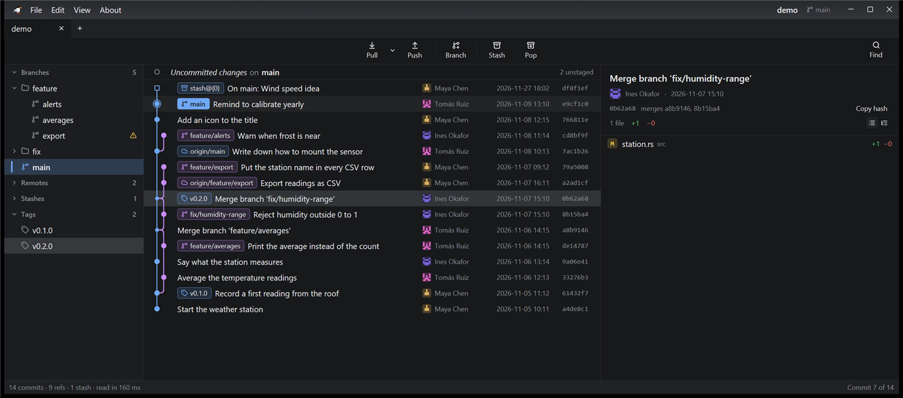
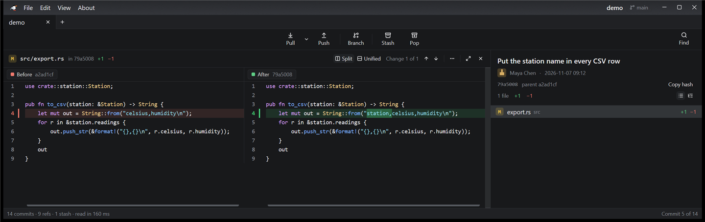

# SterneGit

A fast, small Git client for Windows, Linux and macOS, written in Rust with
[GPUI](https://www.gpui.rs/) (through [gpui-kit](https://github.com/longbridge/gpui-kit))
and [gitoxide](https://github.com/GitoxideLabs/gitoxide).



SterneGit draws your whole history as a graph, lets you stage, commit, pull and push
without a terminal, and compares far more than text: pictures, sound, video and Unity
scenes and prefabs. It is one native executable with no runtime to install, and it
reads even a large history without starting a single process. Keeping it small and
quick matters more here than adding every feature.



## Features

**History**
- A commit graph with a lane per branch, badges for branches, remote branches, tags
  and stashes, and a row for uncommitted changes on top.
- A left pane with branches (grouped in folders by `/`), remotes, stashes, tags and
  worktrees, each showing how far it is ahead or behind its upstream.
- Ctrl+F finds text in the graph, in a comparison or in the conflict editor.
- File history: every commit that changed a file, across renames.

**Changes**
- Stage, unstage and discard files or whole folders; pick several with Ctrl and Shift.
- Commit, amend, and reword any earlier commit by clicking its message.
- Stash, apply, pop and drop stashes.

**Branches and remotes**
- Pull, push and fetch, with a clear choice when a push is rejected or when someone
  else rewrote the upstream.
- Create, check out, delete and merge branches: fast-forward, merge commit,
  squash or rebase.
- Rebase with a conflict editor, cherry-pick, revert and reset, on one commit or on
  several picked at once.
- Tags: create, push, check out and delete, here or on the remote.

**Comparison**
- Code side by side or in one column, with syntax colours and word-level changes.
- Pictures (side by side, swipe, onion skin, difference), sound and video, and a binary view.
- Unity: scenes, prefabs and assets as an inspector with a hierarchy and properties,
  `.meta` files paired with their asset, and a warning when a GUID changes.

**Hosting**
- GitHub and Azure DevOps accounts: clone your repositories, publish a new one, and
  review pull requests. Each host runs as a sandboxed plugin.

**Everywhere**
- One tab per repository, restored on the next start.
- Dark and light themes, and Ctrl+mouse wheel zoom.
- Updates itself in the background on Windows.

## Install

### Windows

Download `SterneGit-Setup-X.Y.Z.exe` from the
[latest release](https://github.com/Sulexa/SterneGit/releases/latest) and run it. It
installs for you alone, without administrator rights, in
`%LOCALAPPDATA%\Programs\SterneGit`, and can add **Open in SterneGit** to folders in
Explorer and SterneGit to your `PATH`.

Prefer no installer? The same release has a portable zip: unpack it anywhere and run
`sternegit.exe`.

Neither is signed yet, so Windows warns the first time: choose **More info → Run
anyway**.

Both look for a new release when they start and every six hours, download it in the
background and install it when you restart or quit SterneGit. Settings → Updates
turns that off.

### Linux and macOS

There are no packages yet: build it from source (below). Pull requests that add
packaging are welcome.

### Requirements

[Git](https://git-scm.com/) 2.26 or newer must be on your `PATH`. SterneGit uses it
for diffs, staging and anything that talks to a remote, so it uses your own
credentials and Git settings.

## Build from source

You need [Rust](https://rustup.rs/). `rust-toolchain.toml` pins the version, and
rustup installs it on the first build.

```sh
git clone https://github.com/Sulexa/SterneGit.git
cd SterneGit
cargo run --release
```

On Linux, install the packages GPUI needs first: Wayland or X11 headers, xkbcommon,
Vulkan and fontconfig. On Debian or Ubuntu:

```sh
sudo apt install libxkbcommon-x11-dev libwayland-dev libvulkan-dev libfontconfig-dev
```

`cargo run --release -- path/to/repository` opens that repository in a new tab.
`cargo run --release -- --check path/to/repository` times how long reading it takes,
without opening a window.

Copies you build yourself never update themselves.

## Using it

SterneGit brings back the tabs that were open last time. With none, it offers **Open
repository…**, **Clone repository…** and **New repository**. The open tabs are saved in
`%APPDATA%\SterneGit\tabs` on Windows, `~/Library/Application Support/SterneGit/tabs`
on macOS and `$XDG_STATE_HOME/sternegit/tabs` (or `~/.local/state/sternegit/tabs`) on
Linux.

Right-click almost anything (a commit, a branch, a tag, a stash, a file) for what you
can do with it. Every action is also in the File, Edit, View and About menus of the top
bar (macOS's own menu bar on a Mac).

On macOS, read Cmd for Ctrl below.

| Key | Action |
| --- | --- |
| ↑ / ↓ | Select the newer / older commit, or the file above / below |
| Ctrl+O | Open a repository |
| Ctrl+Shift+O | Clone a repository |
| Ctrl+N | Create a repository |
| Ctrl+R | Refresh |
| Ctrl+Shift+R | Fetch |
| Ctrl+F, F3, Shift+F3 | Find, next, previous |
| Alt+↑ / Alt+↓ | Previous / next change in a comparison |
| Alt+← / Alt+→ | Previous / next file |
| Esc | Close the comparison |
| Ctrl+Shift+C | Copy the selected commit's hash |
| Ctrl+Tab / Ctrl+Shift+Tab | Next / previous tab |
| Ctrl+W | Close the tab |
| Ctrl+= / Ctrl+− / Ctrl+0 | Zoom in / out / reset |
| Ctrl+, | Settings |

## Contributing

Bug reports, ideas and pull requests are welcome.

- **Report a bug or ask for a feature** in
  [Issues](https://github.com/Sulexa/SterneGit/issues). For a bug, say which version
  (About menu) and system you run, and what you did, what you expected and what
  happened. A small repository that shows the problem helps a lot.
- **Send a change** as a pull request against `develop`, the branch where work
  happens; `master` only receives releases. For anything larger than a fix, open an
  issue first so we can agree on the approach.

A few rules keep the code base the way it is:

- **No comments in the code.** Names, types and tests say what the code does;
  `tests/no_comments.rs` fails the build otherwise. Put the why in the commit
  message.
- **Draw UI changes in the mockup first.** `docs/mockup/` is a browser mockup of every
  screen (open `docs/mockup/index.html`; its README says how to update it). Change it
  in the same pull request as the UI.
- **Mind the size.** Say in the pull request how much the release exe grew. A new
  dependency needs a good reason.
- **Run the tests:** `cargo test`. Don't run `cargo fmt` on the whole crate; it
  rewraps files you didn't touch.
- Commit subjects say what the change does for the user, in the imperative:
  *Copy a branch's name from its right-click menu*.

### How it's built

- `src/git/` reads and changes the repository and knows nothing about the UI. Refs and
  history come from gitoxide inside the process, so a refresh starts no processes
  however large the history is. Patches, staging and network operations go through the
  `git` command, so they match what Git prints in a terminal and use your credentials.
  `graph.rs` gives each commit a lane.
- `src/repo/` is one repository's tab: the panels, and `repository.rs`, which holds
  what was read and runs Git in the background.
- `src/repo/compare/`, `src/media/` and `src/unity/` compare files that aren't plain
  text.
- `src/hosting/` and `connectors/` are the hosting accounts and the sandboxed
  (WebAssembly) plugins for each host.
- `src/ui/` holds the pieces every panel is drawn with; `src/app/` is the window, the
  top bar and the tabs.

### Releasing

To release, set the new version in `Cargo.toml` on `develop`, commit it, and merge
`develop` into `master`:

```sh
git checkout master
git merge develop
git push origin master
```

The Release workflow runs for every push to `master`. It runs the tests, builds the
setup and the portable zip, tags the commit `v` + the version and publishes them with
`latest.json`, the feed installed copies update from. A version with a label, like
`0.4.0-rc.1`, becomes a pre-release that installed copies never update to.
`scripts/package-release.ps1 -Tag v0.4.0` does the same packaging locally when Inno
Setup 6 is installed.

## License

SterneGit is free software under the [GNU General Public License v3.0 or
later](LICENSE). You may use, study, share and change it; if you distribute a changed
version, you must share its source under the same licence.

Contributions are accepted under the same licence: by opening a pull request, you
agree that your contribution is licensed under GPL-3.0-or-later.
